  

  
  
  
  

One tower in my home runs a three-node Kubernetes cluster with 60 self-hosted services behind single
sign-on, intrusion detection, automatic TLS and full observability. Every layer is code in one of five
repositories, and the repositories are wired together so that a merged pull request rebuilds whatever
sits below it.

## From image to running apps

  

Each repository owns one stage and hands the next stage exactly one thing.

| Repository | Owns | Hands over |
|---|---|---|
| [**packer**](https://github.com/Starktastic-Homelab/packer) | The Debian 13 VM template (VM 900), with the guest GPU driver baked in | A manifest, as a pull request in terraform |
| [**terraform**](https://github.com/Starktastic-Homelab/terraform) | The K3s VMs: one control plane and two workers cloned from the template | A `repository_dispatch` to ansible |
| [**ansible**](https://github.com/Starktastic-Homelab/ansible) | The Proxmox host, K3s, and the Argo CD bootstrap | A root app pointing at apps, and the kubeconfig as an organization secret |
| [**apps**](https://github.com/Starktastic-Homelab/apps) | Every workload: 15 infrastructure apps and 60 services, reconciled by Argo CD | The running platform |
| [**.github**](https://github.com/Starktastic-Homelab/.github) | This page and the cross-repo contracts | |

The only manual step is the merge. Merging the manifest pull request replaces the three K3s VMs with
clones of the new image, the deploy reinstalls K3s on them, and Argo CD brings back all 75 apps from Git
in four ordered waves.

## Every workflow, one map

  

Workflows on the self-hosted runner reach the Proxmox API and the cluster; the runner is itself a VM on
the same host. Terraform's apply and Ansible's deploy take the same maintenance lock, so the two never
run at once. Path filters are left out of the tables below; each repository's README has them.

<b>packer</b>: 5 workflows

| Workflow | Runs on | What it does |
|---|---|---|
| `build.yml` | push to `main`, manual | Builds the template, publishes a release, opens the manifest pull request in terraform |
| `validate.yml` | pull request | Validates the Packer template |
| `i915-compat.yml` | pull request, manual | Checks the guest GPU driver pin against the host pin in ansible |
| `format.yml` | pull request, manual | Formats HCL, YAML, JSON and shell, and commits the result |
| `check-debian-iso.yml` | Fridays 09:00 UTC, manual | Opens a pull request when Debian publishes a new ISO |

<b>terraform</b>: 5 workflows

| Workflow | Runs on | What it does |
|---|---|---|
| `validate-and-plan.yml` | pull request | Runs the tests, plans, saves the plan file and comments the plan on the pull request |
| `apply.yml` | pull request merged, manual | Applies the saved plan under the maintenance lock; dispatches ansible if anything changed |
| `drift.yml` | daily 08:00 UTC, manual | Plans against the live state; opens, updates or closes a drift issue |
| `format.yml` | pull request, manual | Formats Terraform, YAML and JSON, and commits the result |
| `readme-images.yml` | pull request that touches Markdown or `docs/diagrams/` | Checks that every image a Markdown file references exists |

<b>ansible</b>: 10 workflows

| Workflow | Runs on | What it does |
|---|---|---|
| `deploy.yml` | dispatch from terraform, push to `main`, manual | Runs the K3s playbook under the maintenance lock, installs Argo CD, hands the kubeconfig to terraform and apps |
| `validate.yml` | pull request, manual | Lint, syntax check and the offline test suites |
| `i915-compat.yml` | pull request, manual | Checks the host GPU driver pin against the guest pin in packer; can call `i915-acceptance.yml` |
| `format.yml` | pull request | Formats YAML and JSON, and commits the result |
| `i915-sriov-upgrade.yml` | push that changes the host driver pin, manual | Installs the host GPU driver, then reboots the host |
| `proxmox-backup.yml` | push that changes the backup role, manual | Deploys the host-side backup |
| `proxmox-guest-startup.yml` | push that changes the startup role, manual | Sets guest boot order and the host's crash behaviour |
| `ser2net.yml` | push that changes the ser2net role, manual | Deploys the Zigbee serial bridge |
| `i915-acceptance.yml` | manual, or called | Proves GPU acceleration works on the running stack or after a reboot |
| `csi-activation-preflight.yml` | manual | Read-only check before changing Proxmox CSI storage |

<b>apps</b>: 5 workflows

| Workflow | Runs on | What it does |
|---|---|---|
| `validate-and-diff.yml` | pull request | Lint, schema validation, policy checks, and an Argo CD diff preview as a comment |
| `refresh.yaml` | push to `main`, manual | Tells Argo CD to refresh the apps a commit touched; it never syncs |
| `format.yaml` | pull request | Formats YAML, JSON and shell, and commits the result |
| `image-scan.yml` | Mondays 06:00 UTC, manual | Scans the referenced container images with Trivy and uploads the results to the Security tab |
| `readme-images.yml` | pull request that touches Markdown or `docs/diagrams/` | Checks that every image a Markdown file references exists |

<b>.github</b>: 1 workflow

| Workflow | Runs on | What it does |
|---|---|---|
| `readme-images.yml` | pull request that touches Markdown or `docs/diagrams/` | Checks that every image a Markdown file references exists |

## The platform

  

| Component | What it is |
|---|---|
| **CPU** | Intel Core i7-12700K (12 cores, 20 threads) |
| **Memory** | 128 GB DDR4 |
| **GPU** | Intel UHD 770 split into seven SR-IOV virtual functions; each K3s worker gets one for transcoding and inference |
| **Hypervisor** | Proxmox VE on a mirrored pair of SSDs |
| **VM disks** | NVMe |
| **NAS** | TrueNAS in a VM with the disk controller passed through: 8× 14 TB HDD in two RAIDz1 pools |
| **Cluster storage** | Retained block volumes through Proxmox CSI, plus NFS from TrueNAS at `10.9.8.30` |
| **Network** | Management VLAN `10.9.9.0/24` and services VLAN `10.9.8.0/24`; every K3s VM has a NIC in each |
| **Kubernetes** | K3s v1.37 on three VMs: one control plane behind a kube-vip address, two workers |

## What is unusual here

- **The plan that was reviewed is the plan that runs.** `validate-and-plan.yml` saves the plan file from
  the pull request, and an ordinary merge applies that exact file. Only the destroy mode and a manual run
  plan again.
- **Drift becomes an issue.** A daily plan against the live state opens an issue when the two differ and
  closes it when they agree again.
- **A GPU driver gate in two repositories.** The guest driver lives in the image and the host driver on
  Proxmox. Both repositories run the same checker on every pull request, each reading the other's pin,
  so an incompatible pair cannot merge.
- **Ordered bring-up from nothing.** Argo CD RollingSync deploys CRDs, then the foundation, then
  controllers, then services, so an empty cluster converges without hand-holding.
- **Secrets work on the first sync.** Ansible seeds the Sealed Secrets key before Argo CD starts, so the
  encrypted secrets already in Git decrypt immediately.
- **One lock for disruptive work.** Applies, deploys and node retirement share a maintenance lock on the
  runner.
- **Backups that leave the building.** Volumes replicate to an encrypted USB pool, restic sends them
  off-site every night, and healthchecks.io watches every run. The
  [restore paths](https://github.com/Starktastic-Homelab/ansible/blob/main/docs/backup-and-restore.md) are
  written down.
- **Decisions are written down too.** 20 architecture decision records live in
  [apps/docs/adr](https://github.com/Starktastic-Homelab/apps/tree/main/docs/adr).

---

  <b>Ben Faingold</b> · Senior DevOps Engineer 
  Product logos in the diagrams are trademarks of their owners and are used only to label the components.

